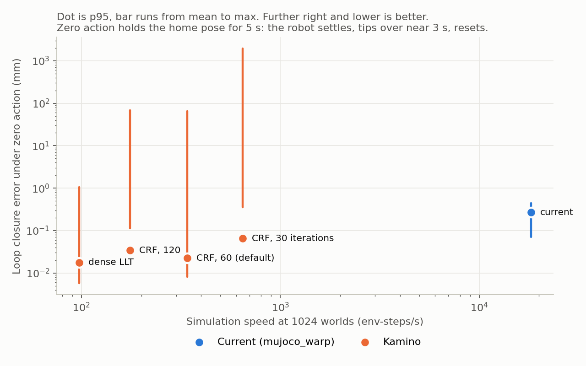

# Kamino against mujoco_warp on kangaroo_full

The closed-chain Kangaroo (4-DoF arms, 24 loops, actuators on the ball screws) on the flat velocity task, 2 ms timestep, decimation 10, measured through the full `ManagerBasedRlEnv.step`. Measured on 2026-11-05 on one GPU, shared with a resident inference service. Rollouts have no noise or randomization unless stated. Tables at the end come from `scripts/bench_kamino.py`. Numbers before the "Blow-ups under exploration" section were measured before the error bounds it describes.

## Result

**Recommendation: stay on mujoco_warp for training.** At settings fast enough for RL, Kamino is about 54 times slower and cuts typical loop error by about half. Its 3 h run blew up under exploration noise and didn't learn. Bounding the error correction later cut those blow-ups about 35 times, but no full training run has used it. mujoco_warp's soft loops already stay within about 1.3 mm while walking.

| | mujoco_warp | Kamino, CRF 60 (default) | Kamino, dense LLT |
|---|---|---|---|
| Env-steps/s at 1024 worlds | 18,198 | 340 | 98 |
| Env-steps/s at 4096 worlds | 20,521 | 361 | not run |
| Loop error walking, mean / p95 / max (mm) | 0.111 / 0.652 / 1.26 | 0.054 / 0.554 / 21.0 | not run |
| Loop error zero action, mean / p95 / max (mm) | 0.070 / 0.267 / 0.445 | 0.031 / 0.130 / 17.4 | 0.009 / 0.034 / 0.329 |
| Solves reaching tolerance, zero action | n/a | 5% | 98% |
| Reward after 3 h of training | 80.6 | -0.09 | not run |

The bridge looks sound for normal motion: the baseline policy, trained on mujoco_warp, walks on Kamino for 20 s in all 256 worlds without a fall. Over a separate 10 s run it averaged 0.94 m/s on Kamino and 0.97 m/s on mujoco_warp, against a 1 m/s command.

## Speed

Kamino's bars use its own body poses, described below.

- Kamino's speed barely changes with world count: 320, 340 and 361 env-steps/s at 256, 1024 and 4096 worlds. mujoco_warp goes from 9,873 to 20,521.
- Walking doesn't close the gap: 17,535 against 343 env-steps/s at 1024 worlds, 51 times slower.
- Speed follows the iteration budget: 647, 340 and 176 env-steps/s at 30, 60 and 120 PADMM iterations. Each PADMM iteration runs 30 inner linear solver iterations.
- Fewer iterations isn't an option: at 30, the worst loop reaches 861 mm and only 3% of solves reach tolerance.

## Constraint violation

Loop error is the distance between the two sites of each `<connect>`, read from `site_xpos` with the same code on both simulators. "Kamino bodies" is the same distance on Kamino's own body poses, before they are mapped to `qpos`, because that mapping can hide error.

Walking 20 s with the baseline policy is the fairest comparison, since neither simulator falls:

| Walking, 256 worlds | mujoco_warp | Kamino |
|---|---|---|
| Loop error, mean / p95 / max (mm) | 0.111 / 0.652 / 1.26 | 0.054 / 0.554 / 21.0 |
| Kamino bodies, mean / p95 / max (mm) | n/a | 0.020 / 0.078 / 84.8 |
| Mean by group: hip / ankle / knee (mm) | 0.054 / 0.142 / 0.132 | 0.032 / 0.079 / 0.020 |
| Loop velocity, mean / max (mm/s) | 2.06 / 87.8 | 1.93 / 2,500 |
| Tree joint residual, p95 / max (mm or mrad) | 0 by construction | 0.034 / 927 |
| Solves reaching tolerance in 60 iterations | n/a | 0% |

A separate 10 s walking run located Kamino's large maximums in time. All of them came in the first 0.5 s, as the robot settles from the reset pose:

| Walking 10 s, 256 worlds, 128,000 world-steps | mujoco_warp | Kamino |
|---|---|---|
| Worst loop error in the first 0.5 s (mm) | under 1.3 | 10.0 |
| World-steps over 5 mm after 0.5 s | 0 | 0 |
| World-steps over 1 mm after 0.5 s | 20,194 (16%) | 4,790 (3.7%) |

So once the robot is walking, Kamino holds its loops better. It isn't clean, though: some body exceeded 10 m/s on 673 world-steps (0.5%), peaking at 38 m/s, where mujoco_warp's fastest body reached 4.2 m/s. That run didn't record when those happened.

The zero-action rows aren't quiet standing. The home pose isn't balanced, so the robot settles, tips over near 3 s (timed on mujoco_warp), resets and lands again. Kamino also records one fall per world, and those events probably set its maximums.

Dense LLT is what converged Kamino looks like: about 7.5 times lower mean loop error than mujoco_warp, at 186 times the cost. More CRF iterations don't remove the outliers: 120 iterations still reach 133 mm.

Kamino's RL warm start and the position-matching one are indistinguishable here: same speed, same mean and p95. A single short check at 1024 worlds once showed 230 mm against 0.075 mm, but the longer runs don't confirm it.

## Training

| 3 h run | Baseline | Kamino |
|---|---|---|
| Worlds | 4096 | 1024 |
| Iterations | 2,025 | 151 |
| Samples | 199 M | 3.7 M |
| Final mean reward | 80.6 | -0.09 |
| Final episode length (steps) | 1000 | 16 |
| At 3.64 M samples: reward / episode length | 4.0 / 149 | -0.03 / 17.5 |
| Worst value loss over the first 150 iterations | 0.40 | 650,568 |

The Kamino policy learned to end episodes quickly: length fell from about 100 steps to 16 while reward rose towards zero, because each step was costing reward on average. It does the same on mujoco_warp (59.5 episode ends per world in 20 s, 57.2 on Kamino), so the result is in the policy, not only in the simulator.

The likely cause is blow-ups during exploration. In the logs, `foot_slip` averaged as low as -16 (baseline worst -0.005), and the learning rate sat at its 1e-5 floor on 79 of 151 iterations. A one-off run of the training environment, randomization on, with actions drawn from N(0, 1), shows the blow-ups directly:

| 1024 worlds, 120 env steps | mujoco_warp | Kamino |
|---|---|---|
| Max body speed (m/s) | 7.6 | 80,850 |
| World-steps with a body over 10 m/s | 0 | 1,386 (1.1%) |
| Max loop error (mm) | 2.53 | 679 |
| Worst single-step reward | -0.6 | -270 |

There were no NaNs in training, so the `nan` termination never fired. The next section covers what triggers the blow-ups.

Even with that fixed, the budget is the limit. The baseline reached reward 40 and 849-step episodes at iteration 300 (29.5 M samples, 27 min). At Kamino's 344 samples/s, the same samples take about 24 h.

## Blow-ups under exploration

Blow-ups need random actions and ground contact together. These are one-off runs of the training environment, one per case, at 256 worlds and 200 env steps, before the bounds below. An event is a world where a body passes 10 m/s.

| Case | Events | Top body speed (m/s) |
|---|---|---|
| Random actions, randomization, pushes | 20 | 70.9 |
| Random actions only | 15 | 142 |
| Pushes only, zero action | 1 | 44.1 |
| Randomization only, zero action | 0 | 4.3 |
| Random actions, no ground or gravity | 0 | 2.3 |
| mujoco_warp, random actions, randomization, pushes | 0 | 6.7 |

The evidence fits this sequence: PADMM falls behind at foot contact, a loop opens, and Kamino's Baumgarte correction, which grows with the gap, feeds energy in. At events the foot has sunk 1-6 cm and ankle roll reads 2.2-5.3 rad against a +/-0.471 rad limit. Solver budget alone doesn't fix it: dense LLT with 200 iterations still had 15 events.

`max_joint_error` (0.02 m or rad) and `max_limit_error` (0.05) now bound the error the correction acts on. Below them nothing changes. Pushes also keep the solver's warm start, since they only write velocities.

| Random actions, randomization, pushes | Without bounds, 4 runs | With bounds, 6 runs |
|---|---|---|
| Events | 94 | 4 |
| Top body speed (m/s) | 93-180 | 4.7-30 |
| World-substeps with a body over 10 m/s, per run | 445-988 | 0-92 |
| Loops over 20 mm, share of world-substeps | 1.2-1.4% | 0.32-0.52% |
| Loops over 100 mm, world-substeps per run | 185-290 | 0-58 |

Both columns keep the warm start through pushes. GPU runs don't repeat at a fixed seed: with bounds, seed 1 gave 0, 1 and 1 events. So single runs in this section only support large differences.

The bounds have a cost in normal motion. Typical error is unchanged, but rare gaps get larger:

| Normal motion | Without bounds | With bounds |
|---|---|---|
| Walking 20 s, loop mean / p95 / max (mm) | 0.054 / 0.554 / 21.0 | 0.055 / 0.555 / 65.2 |
| Walking 20 s, loop velocity max (mm/s) | 2,500 | 7,411 |
| Zero action 5 s, loop mean / p95 / max (mm) | 0.031 / 0.130 / 17.4 | 0.036 / 0.130 / 58.8 |
| Walking 10 s, worst loop error (mm) | 10.0 | 41.5 |
| Walking 10 s, world-steps over 5 mm after 0.5 s | 0 | 25 |
| Walking 10 s, world-steps with a body over 10 m/s | 673 | 649 |
| Walking 10 s, fastest body (m/s) | 38 | 12.3 |
| Env-steps/s at 1024 worlds | 340 | 348 |

Neither walking run has a fall. In the worst world of the 10 s run, Kamino's own bodies close the gap in about 60 ms while the gap from `qpos` stays near 41 mm. The error seems to sit in tree joints, which the bound may close slowly. That isn't tested.

Whether Kamino now trains is unknown. An 18-iteration probe at 1024 worlds with a tighter 5 mm joint bound had a worst value loss of 4.27 (650,568 without bounds, 0.40 on the baseline), and episode length tracked the baseline. But the learning rate stayed between 1e-5 and 2.3e-5, where the baseline reaches 2.2e-3. At the event rate above, a 1024-world run would still see roughly one blow-up every 3 iterations, an estimate from pure random actions.

These didn't help, in one-off runs:

- Fewer iterations, even with bounds: 30 PADMM iterations had 731 events, and 15 inner iterations ran 1.75 times faster with 19 events. 25 inner iterations has no result.
- A lower preconditioner cap had 617 events, and rho 0.01 on CRF had 6,606.
- Small model changes barely move convergence. On dense LLT on CPU (4 worlds, 15 env steps, 114 iterations unchanged), inertia floors gave 112-118, soft contacts 111-113, and two sole capsules per foot 100.
- By a matrix estimate, raising every light body to 0.2 kg adds 3.77 kg for about 22% fewer iterations.

## Caveats

- Kamino's contacts, limits and friction are hard where MuJoCo's are soft, so a difference in policy behaviour is expected and isn't by itself a defect.
- The two training runs differ in world count (4096 and 1024). Kamino's speed doesn't grow with worlds, so 1024 gives it more policy updates in 3 h.
- Kamino raises placeholder bodies to 0.01 kg (`min_body_mass`), adding 0.04 kg in total. It also skips joint friction below 0.05 (`min_frictionloss`).
- Metrics are read after resets, so the state a world ends in isn't measured on either simulator.
- The working solver settings came from a sweep on this model: CRF, 30 inner and 60 PADMM iterations, rho 0.05, tolerance 1e-3. Other solvers or tuning could do better. Kamino's own RL setting (9 inner iterations) diverged on foot contact.
- Both simulators use the on-load model fixes in `kangaroo_full_constants.py`. These belong upstream in `kangaroo_simulation`.
- `ankle_tibia_bar_l2` on both legs has 40% less inertia than its three sibling 380 mm bars. It doesn't affect convergence, is left unchanged and should also be fixed upstream. Left and right masses otherwise match within 2%.

## Open question

Is +/-0.02437 m the real ankle screw travel? It stops pure ankle pitch at +0.52 rad, short of the +0.663 rad joint limit, which needs -0.0263 m. It's left unchanged.

## Benchmark tables

`stand_*` is zero action for 5 s and `walk_*` is a 1 m/s command for 20 s, both at 256 worlds. `policy_mjw` and `policy_kam` are the baseline and Kamino policies. "Falls per world" counts every terminated episode. Only `*_bounds` rows use the error bounds.

| Case | Env-steps/s | Physics substeps/s |
|---|---|---|
| speed_mjwarp_256 | 9873 | 170380 |
| speed_kamino_256 | 320 | 3237 |
| speed_mjwarp_1024 | 18198 | 239328 |
| speed_kamino_1024 | 340 | 3438 |
| speed_mjwarp_4096 | 20521 | 240384 |
| speed_kamino_4096 | 361 | 3622 |
| speed_kamino_1024_b30 | 647 | 6664 |
| speed_kamino_1024_b120 | 176 | 1754 |
| speed_kamino_1024_dense | 98 | 972 |
| speed_kamino_1024_rl_warmstart | 341 | 3428 |
| speed_mjwarp_1024_walk | 17535 | 247248 |
| speed_kamino_1024_walk | 343 | 3446 |
| speed_kamino_1024_bounds | 348 | 3499 |

| Case | Loop mm mean | p95 | max | Kamino bodies mm max | Loop mm/s mean | Tree mm or mrad max | PADMM iterations | Converged | Falls per world | NaN |
|---|---|---|---|---|---|---|---|---|---|---|
| stand_kamino_b30 | 0.734 | 0.458 | 860.665 | 1925.958 | 712.31 | 2158.756 | 29.1 | 0.03 | 1.42 | 0.000 |
| stand_kamino_b120 | 0.068 | 0.145 | 132.529 | 67.925 | 4.58 | 975.539 | 93.4 | 0.61 | 1.00 | 0.000 |
| stand_kamino_dense | 0.009 | 0.034 | 0.329 | 1.064 | 0.32 | 42.650 | 37.2 | 0.98 | 1.00 | 0.000 |
| stand_kamino_rl_warmstart | 0.031 | 0.128 | 10.358 | 51.310 | 0.42 | 608.779 | 58.1 | 0.05 | 1.00 | 0.000 |
| stand_mjwarp | 0.070 | 0.267 | 0.445 | - | 0.22 | - | - | - | 1.00 | 0.000 |
| walk_mjwarp_policy_mjw | 0.111 | 0.652 | 1.256 | - | 2.06 | - | - | - | 0.00 | 0.000 |
| walk_mjwarp_policy_kam | 0.094 | 0.870 | 0.997 | - | 1.06 | - | - | - | 59.51 | 0.000 |
| stand_kamino | 0.031 | 0.130 | 17.440 | 65.403 | 0.43 | 828.148 | 58.1 | 0.05 | 1.00 | 0.000 |
| walk_kamino_policy_mjw | 0.054 | 0.554 | 20.975 | 84.822 | 1.93 | 926.831 | 60.0 | 0.00 | 0.00 | 0.000 |
| walk_kamino_policy_kam | 0.053 | 0.609 | 2.106 | 3.041 | 2.18 | 23.137 | 57.3 | 0.10 | 57.17 | 0.000 |
| stand_kamino_bounds | 0.036 | 0.130 | 58.823 | 68.203 | 0.43 | 840.652 | 58.1 | 0.05 | 1.00 | 0.000 |
| walk_kamino_policy_mjw_bounds | 0.055 | 0.555 | 65.239 | 87.977 | 1.95 | 929.065 | 60.0 | 0.00 | 0.00 | 0.000 |

| Training run | Iterations | Hours | Mean reward | Mean episode length |
|---|---|---|---|---|
| mjwarp | 2025 | 2.99 | 80.65 | 1000 |
| kamino | 151 | 2.97 | -0.09 | 16 |
