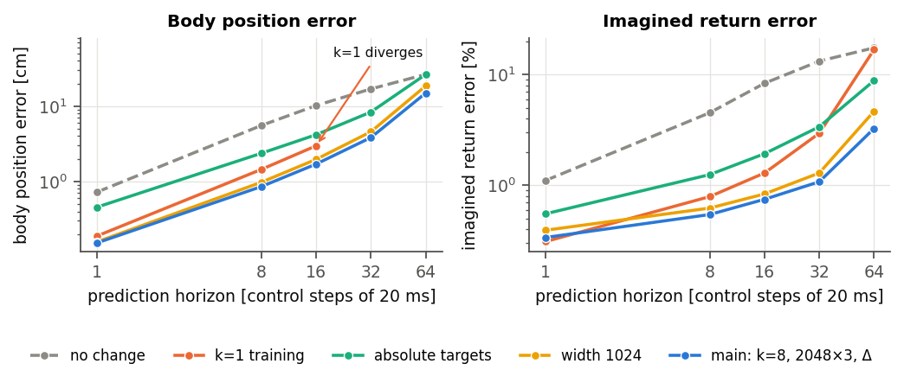
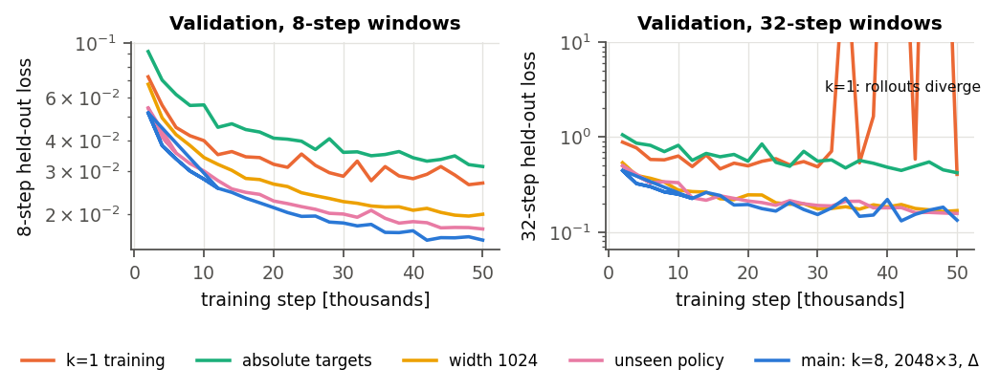
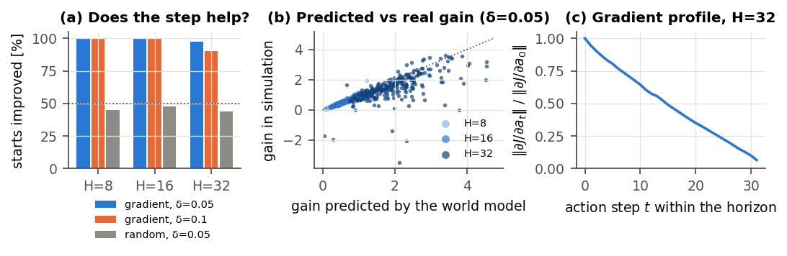
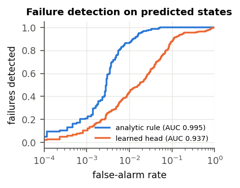

# M2: offline world model (2026-10-23)

The full write-up, with method and protocol from the ground up, is [report.pdf](report.pdf) (source
`report.tex`). Figures and tables come from `make_figures.py`, which reads `logs/supermimic_m2/eval/*.json`
and the TensorBoard logs.

**Question.** Can the paper's world model stand in for the simulator on Kangaroo before any policy is
trained on it?

**Answer.** Yes, up to the paper's horizon (H = 32).
- Its action gradients improve the simulated return.
- The learned failure head is the weak part; the env's analytic failure rule on predicted states works.

## Setup

- **Data:** 6.14M transitions.
  - Three PPO-Sim checkpoints (iterations 1000, 4000, 8800) × 4096 envs × 500 steps, on `dev`.
  - Action noise N(0, 0.1²), paper DR per episode, terminal states kept (D29).
  - Failures: 1480 / 417 / 1073, i.e. 0.05% of transitions.
- **Split:** 118 of 1296 clips held out by name hash. Every number below is on held-out clips.
- **Model (main):** heading-invariant 77-dim state (D4), MLP 2048×3 ELU, predicts the normalized state
  change plus the heading-frame pose change; k = 8 windows (paper Eq. 1); Adam 2e-4; batch 2048; 50k
  steps; 43 min.
- **Reward:** analytic, via torch FK. Its parity with the env's reward is 1.6e-5.

## Open-loop accuracy (main model vs no-change floor)

| horizon (steps of 20 ms) | 1 | 8 | 16 | 32 | 64 |
|---|---|---|---|---|---|
| body error, cm (p95) | 0.15 (0.32) | **0.86** (1.82) | 1.70 (3.57) | **3.83** (8.19) | 14.9 (33.1) |
| no change, cm | 0.73 | 5.55 | 10.2 | 16.9 | 26.4 |
| imagined return error | 0.3% | 0.5% | 0.8% | **1.1%** | 3.3% |

- **Root at 32 steps:** height 0.35 cm, tilt 2.1°, planar drift 2.6 cm.
- **By group (root-relative):** arms 4.4 cm, legs 2.1 cm, torso 0.24 cm. The arms carry the error, as in
  PPO-Sim.
- **Beyond 32 steps:** at 64 steps the model is only 1.8× better than no change. H = 32 is the useful
  limit.

## Ablations (one change each)

| model | 8 steps, cm | 32 steps, cm | note |
|---|---|---|---|
| **main** (k=8, 2048×3, Δ) | **0.86** | **3.83** | 43 min |
| width 1024 | 0.98 | 4.58 | 2.4M params, 16 min |
| absolute targets | 2.37 | 8.36 | 3× worse at 1 step |
| k = 1 training | 1.45 | diverged | 1-step error 0.19 cm, then compounds |
| unseen policy (no iteration-4000 data), tested on that policy | 0.93 (main 0.82) | 4.18 (main 3.60) | ≈ +15% |

## Gradients (256 held-out starts, replayed open loop in the simulator)

| H | gradient step improves the simulated return (δ = 0.05 / 0.1) | random direction | predicted vs real gain (δ = 0.05) | corr |
|---|---|---|---|---|
| 8 | 100% / 100% | 45% | 0.24 vs 0.23 | 0.95 |
| 16 | 100% / 100% | 47% | 0.68 vs 0.63 | 0.96 |
| 32 | 97% / 90% | 44% | **1.98 vs 1.50** | 0.62 |

- **Direction:** right almost always.
- **Size:** accurate up to H = 16; at H = 32 the model is optimistic (+32% at δ = 0.05, +57% at
  δ = 0.1).
- **Gradient-norm profile:** ‖∂J/∂a_t‖ decays near-linearly along the horizon (0.54 → 0.035 at
  H = 32), with no sign of explosion or vanishing.
- **Replay fidelity:** replay matches the logged return to ≤ 0.003.

## Failure prediction (held-out, scored on predicted states)

- **Learned head:** AUC 0.937 (gate 0.95); 0.872 for a policy it never saw.
- **Env rule on predicted states:** AUC 0.995 (0.997 under policy shift).
- **The head is the problem, not the states.** With perfect states the head reaches only 0.954.
- **Hard rule:** catches 81% of failures at the exact step, with 0.02% false alarms.

## Gates

| gate | result |
|---|---|
| 8-step body error < 2 cm mean / 5 cm p95 | pass (0.86 / 1.82) |
| 32-step rollouts bounded, < 10 cm | pass (3.83, all finite) |
| imagined return error < 10% | pass (1.1%) |
| gradient steps beat random | pass |
| failure AUC > 0.95 | **head fails (0.937)**, rule passes (0.995) |
| k = 8 beats k = 1 | pass |

## For M3 and M4

- **World model:** `logs/supermimic_m2/wm/main/wm_best.pt` for M3 (D30). M4 trains the same
  configuration online from scratch.
- **Termination (D31, user decision):** the paper's learned head stays the default. The env's rule,
  d̂ = σ((m − 1)/τ) with τ ≈ 0.05, is one config switch away and is always computed and logged next to
  it, with AUC on fresh sim data, survival weights and disagreements. If the head lags, M4 runs the rule
  variant.
- **Model optimism at H = 32:** log the imagined vs simulated return from the start, and keep the
  paper's small steps and clipping. Try H = 16 in M4 if the gap grows.
- **M3 is a ~1 h code check, not a frozen-model training run.** The paper never trains on a frozen
  model; its online refits stop model exploitation. With the PPO-Sim actor on the M2 model, M3 runs:
  1. imagined vs simulated return, closed loop, no training;
  2. a critic fit with the actor fixed, then a few hundred update iterations, to check gradients,
     clipping and the critic.
  The critic ablation moves to M4. See the report, section 7.

Not ablated: the "10 batches" reading (D10) is an online-loop question and moves to M4. The normalizer
ablation was dropped, since nothing pointed at it.
