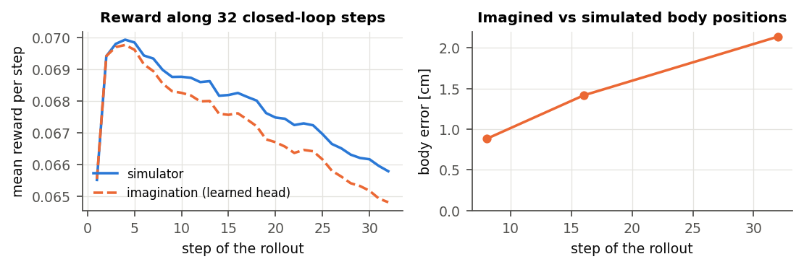
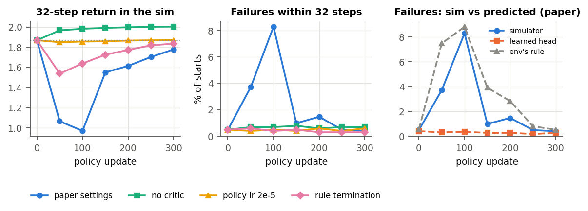
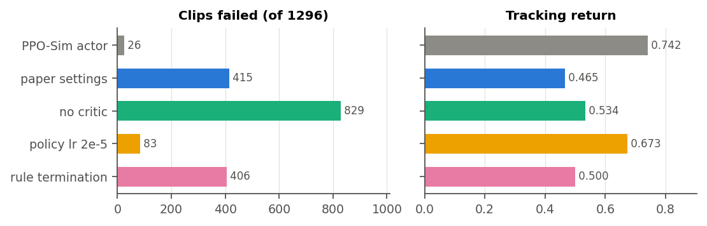

# M3: imagination and the policy update (2026-10-23)

Full write-up: [report.pdf](report.pdf) (source `report.tex`). Figures and tables come from
`make_figures.py`, reading `logs/supermimic_m3/*.json`.

**What M3 checks.** The code of SuperMimic's policy update, on the frozen M2 world model: Eq. 2 by
BPTT through imagined 32-step rollouts, plus the critic of Eq. 3. The paper never trains a policy on a
frozen model, so these are checks of the code M4 runs. They use the PPO-Sim actor, the same network
(D17), with replay states of that same policy.

## Built

- **Analytic heads** (`rl/heads.py`, D32): reward, observation (10-frame history, sensor noise), goal,
  critic input and failure rule, computed from the predicted state with the env's own definitions.
  - Parity with the env on true states: 1e-4, and 1e-5 for the reward; flags match exactly.
- **Replay buffer** (`rl/replay.py`, D33): 1000 rows per env, terminal states as their own rows.
  - Windows and imagination starts never cross an episode end.
- **Updates** (`rl/supermimic.py`): Eq. 1, Eq. 2 with the survival weight, and the λ-returns of Eq. 3.
  - Table A.5 settings: optimizers, clipping, cosine schedule.
  - Tested: λ-return limits, the BPTT gradient against finite differences, the world model and critic
    frozen in the policy step.
- **Online loop** (`rl/runner.py`): Alg. A.1 as an mjlab runner, so mjlab's `train` and `play` drive it.
  - Logs the imagined vs simulated return gap and the learned head vs the rule on fresh failures (D31).
- **Data from the CLI** (D35): a dataset folder, possibly relative, plus a subset (`dev`, `full`,
  hours). Missing subsets are packed on first use. The dataset folder is
  `kangaroo_bones_seed/dataset/` (motions `.pkl` + libraries `.npy`), also downloadable from the motion
  browser.

## Check 1: imagination reproduces the simulator in closed loop

The PPO-Sim actor acts for 32 steps in imagination and in the sim, from 1024 held-out starts. Both
sides have the same state, ξ, reference and observation history, and no noise.

| | 32-step return | gap | failures |
|---|---|---|---|
| simulator | 1.869 | | 0.49% |
| imagination, learned head | 1.852 | −0.9% | 0.40% |
| imagination, env's rule | 1.852 | −0.9% | 0.56% |

- Across starts the imagined and simulated returns correlate at 0.995.
- Imagined vs simulated body positions differ by 0.9, 1.4 and 2.1 cm after 8, 16 and 32 steps.

## Check 2: 300 policy updates on the frozen model

**Setup.** First 200 iterations fit only the critic, with the actor fixed: the loss falls from 0.29 to
0.043, and V matches its λ-return (5.13). Then 300 policy updates follow, with check 1 every 50 and
the paper's benchmark (every `dev` clip from its first frame) at the end. Four runs, each one change
from the paper settings:

| policy | failed (of 1296) | tracking return | arms [cm] | 32-step return | worst gap |
|---|---|---|---|---|---|
| PPO-Sim actor (start) | 26 | 0.742 | 10.8 | 1.869 | |
| paper settings | 415 | 0.465 | 19.4 | 1.778 (dips to 0.97) | 25% |
| without the critic | **829** | 0.534 | **8.9** | **2.003** | 0.4% |
| policy lr 2e-5 | 83 | 0.673 | 12.5 | 1.869 | 0.4% |
| env's rule as termination | 406 | 0.500 | 16.1 | 1.835 (dips to 1.54) | 0.8% |

**Findings.**
- **The update machinery works.** Without the critic, the BPTT gradient raises the real 32-step return
  by 7%, and imagination tracks it within 0.4% throughout. In every run imagination follows the sim as
  the policy changes.
- **The 32-step objective alone is myopic.** Without the critic, arm tracking improves (10.8 → 8.9 cm)
  but 829 of 1296 clips fall. This is the paper's case for the critic.
- **On a frozen model the critic is the weak link.**
  - Its long-horizon judgement comes from imagination of the old policy's states, so every
    paper-learning-rate run loses whole-clip tracking (406–415 failures).
  - A 10× smaller step limits the damage (83).
  - In M4, real falls reach the replay, then the world model, then imagination, then the critic.
- **The frozen learned head missed the new policy's failures**, as discussed for D31.
  - At update 100 the sim failed 8.3% of starts; the head predicted 0.4% and the rule 8.8%.
  - With falls free in imagination, the critic's values rose from 5.1 to 7.9 and the 32-step return
    dipped to 0.97.
  - With the rule, the dip is milder (1.54) and sim failures stay ≤ 0.6%.
  - The whole-clip damage is the same with either termination.

**Gate.**
- Check 1 passes.
- The update machinery passes: gradients, critic fit and clipping work, and imagination tracks the sim.
- The policy did not hold on whole clips in any frozen-model run.
- We read this as the reason the paper refits online, not a code defect. M4 must watch it.

## Ready for M4

| run | where | command (see `../README.md`) |
|---|---|---|
| `dev` | local 16 GB | `--env.commands.motion.subset dev --agent.algorithm.precision bf16 --agent.replay-steps 500` |
| `dev` | cluster | `--env.commands.motion.subset dev` (paper settings: TF32, replay 1000) |
| `full` | cluster | `--env.commands.motion.subset full` (library 13.9 GB on the GPU) |

**Local smoke run** of the M4 task, from scratch, 60 iterations:
- 1.57 s per iteration (collect 0.15 s, world model 0.31 s, policy and critic 1.11 s), so about 2,300
  iterations per hour; peak memory 11.3 GB.
- The imagined vs sim 32-step return gap is already within −5…+2%.
- The learned head's AUC on fresh failures rose from 0.42 to 0.81; the rule's stayed at 1.0.

The paper settings ran out of memory locally (TF32 imagination: about 12.7 GB, plus the sim and the
replay).

**Watch in M4:**
- `episode/failure` and `episode/length` in the sim;
- `eval/return_gap_head`;
- `termination/head_auc` vs `termination/rule_auc`, and `eval/imagined_failure_head` vs
  `eval/sim_failure`;
- the whole-clip benchmark of checkpoints (`eval.py`), because the 32-step checks cannot see falls
  that happen later.
