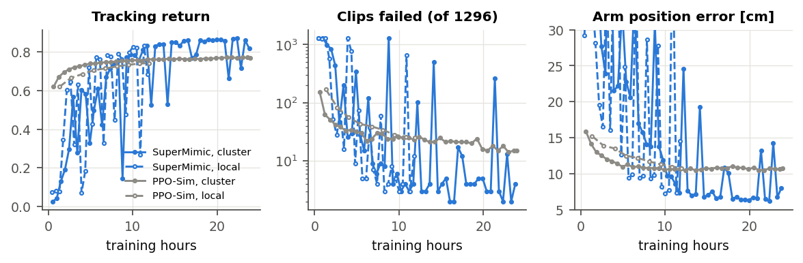
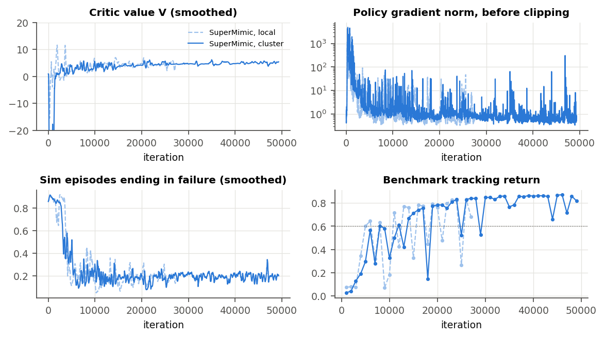

# M4 on the cluster: the paper's settings vs PPO-Sim (2026-10-25)

Full write-up: [cluster_report.pdf](cluster_report.pdf) (source `cluster_report.tex`). Figures and tables
come from `make_cluster_figures.py`, which reads the TensorBoard logs and benchmark JSONs of all four runs.

**What ran.** Two 24 h jobs on Leonardo, one A100 64 GB each, started together from commit `9d58dab` on
the `dev` library (1296 clips, 2.5 h):
- **SuperMimic** with the paper's settings: TF32 and replay 1000, the two settings the 16 GB local GPU
  can't fit (D16). Run `supermimic_wm_1hz/2026-10-24_11-21-34_dev-paper`.
- **PPO-Sim**, unchanged. Run `supermimic_ppo_sim_1hz/2026-10-24_11-21-37_dev-cluster`.
- **Benchmark:** every checkpoint was benchmarked on the local GPU with M4's protocol: every clip once from
  its first frame. Runs are compared at equal hours, one seed each.
- **CUDA graphs:** the nodes' driver (CUDA 12.2) disables them, which made the simulator about 8× slower.
  The forward-compatibility libcuda of `cuda/12.6` fixes it (LEARNINGS, Cluster).

| run | iterations in 24 h | s/iteration | sim steps |
|---|---|---|---|
| SuperMimic, A100 | 49,300 | 1.78 (policy 1.37, WM 0.25, collect 0.16) | 0.50 B |
| PPO-Sim, A100 | 38,677 | 2.2 (collect 1.54, learn 0.68) | 7.6 B |

| checkpoint | hours | failed (of 1296) | tracking return | legs / arms / torso [cm] |
|---|---|---|---|---|
| PPO-Sim, cluster, last | 23.9 | 15 | 0.770 | 6.2 / 10.7 / 2.6 |
| SuperMimic, cluster, first above it | **9.3** | 4 | 0.773 | 6.3 / 13.7 / 2.3 |
| SuperMimic, cluster, best | 22.3 | **2** | **0.872** | **4.4 / 6.2 / 1.8** |
| SuperMimic, cluster, last | 23.8 | 4 | 0.819 | 5.4 / 8.0 / 2.5 |
| SuperMimic, local (M4), best | 11.3 | 3 | 0.832 | 5.0 / 7.3 / 1.7 |

## Findings

- **SuperMimic beats PPO-Sim on equal hardware.**
  - PPO-Sim runs 2.2× faster than locally but plateaus: 0.745 at 6.2 h, 0.770 at 24 h.
  - SuperMimic passes PPO-Sim's 24 h result at 9.3 h. Of its 31 later checkpoints, 25 have a higher
    return and 27 fewer failures.
  - Its best checkpoint fails 2 clips. Its arm error is 41% lower than PPO-Sim's best, legs 28% and
    torso 31%.
  - It uses 15× less simulator data.
- **The paper's settings don't remove the oscillation.**
  - Over iterations 5,000–27,000 the cluster run has 20 failure spikes, the local one 11, with the same
    critic-first sequence.
  - The benchmark shows collapses at 8.8 h (1287 failures), 12.2, 14.1 and 21.4 h. So bf16 and replay 500
    are not the cause.
  - Spikes do thin out with training (14, 6, 2, 2 per ~11k iterations).
- **A late failure mode.** After iteration 27,000, a few imagined rollouts get enormous penalties: the
  batch-mean imagined reward reaches −18,700 per step and the critic loss 10^14. Only the action-rate and
  joint-limit terms are unbounded, and the logs don't say which one fires.
- **It starts more slowly than locally:** 0.742 at 8.3 h vs 5.7 h, after a larger start-up critic
  transient.
- **Speed is our largest gap to the paper.** One A100 gives 8× fewer iterations per GPU than the paper;
  about 3× of that is the H100. The iteration is bound by the BPTT update, which isn't compiled.
- **Gate (≥ PPO-Sim on `dev`):** met at equal hours from 9.3 h and at the best checkpoint. Stability is
  not met, and the critic ablation is still open.

## Options for M5 (report §5, ROADMAP M5; nothing changed yet)

1. **Speed:** profile, then compile the whole imagination and WM-loss steps (the reproduction measured
   4.5×). Cost: code and about 2 h of local benchmarks.
2. **Stability, one change per local 12 h run:**
   - a calmer sampler;
   - a small failure head on the rule's features;
   - the clean previous action in obs (D9);
   - learning rate or −J/H; critic inputs (D7) and normalization (D34);
   - first, log what makes the extreme imagined rewards.
3. **G1 control (D18)**, with the reproduction as reference: separates Kangaroo from our implementation.
4. **Critic ablation and push test**, still open from M4.
5. **Multi-GPU** (explicit all-reduce, lr × √N): about 2 A100-h to test.
6. **`full` on the cluster:** 24 A100-h per run, about 190 local budget hours.
7. **The paper's two results:** 10–50 and 60–160 A100-h at today's speed, a third to a quarter after (1).
8. **Data sweep** (1, 10, 40 h).

Budget: about 4,560 local hours (≈ 570 A100-h) left on Leonardo.
