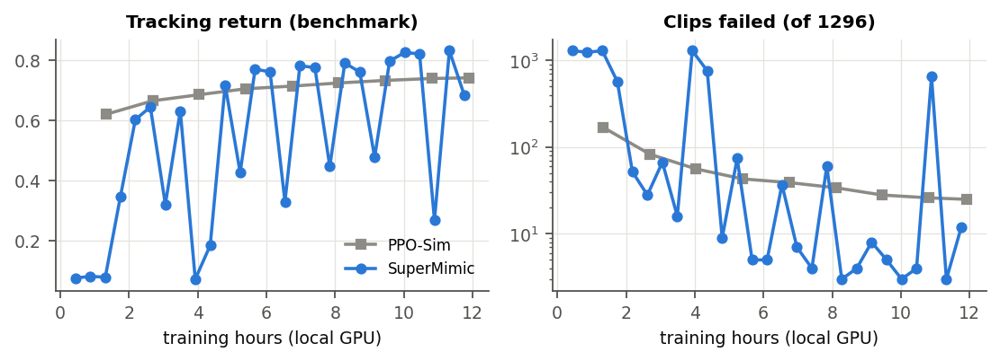
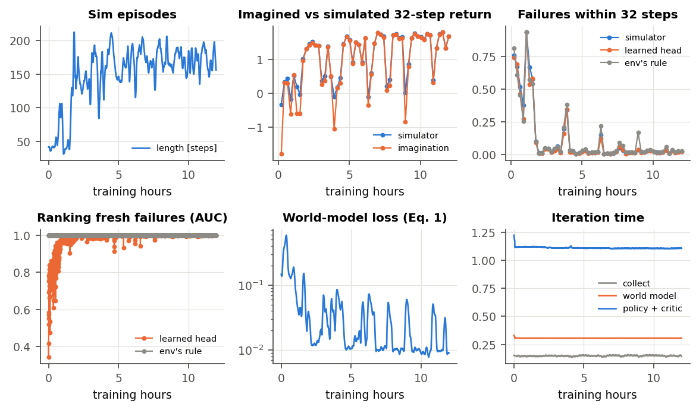
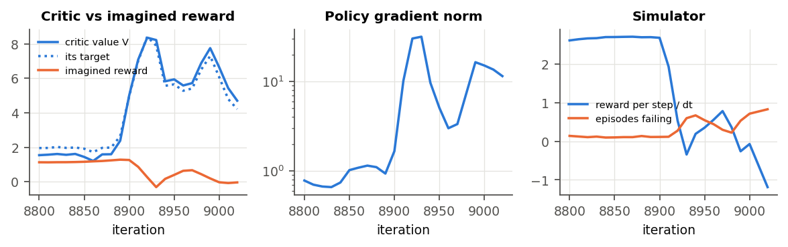

# M4: the online loop on `dev` (2026-10-24)

Full write-up: [report.pdf](report.pdf) (source `report.tex`). Figures and tables come from
`make_figures.py`, reading the TensorBoard logs and the benchmark JSONs of both runs.

**What ran.** SuperMimic (Alg. A.1) from scratch on `dev`. The environment, gains and 12 h local-GPU
budget are the same as the PPO-Sim baseline's.
- Settings: Table A.5, with the learned failure head (D31) and the critic.
- Two deviations forced by the 16 GB GPU (D16): bf16 learning updates and a replay of 500 steps per env.
- Run: `logs/rsl_rl/supermimic_wm_1hz/2026-10-23_20-13-19_dev-local`.
- 27,510 iterations, 1.57 s each, 11.3 GB, no interruption; about 0.28 billion simulator steps, against
  1.7 billion for PPO-Sim.

**Benchmark.** All 27 checkpoints (one per 1000 iterations) were played on every `dev` clip once from
its first frame, the paper's protocol (`eval.py`), the same as PPO-Sim's checkpoints.

| policy | hours | failed (of 1296) | tracking return | legs / arms / torso [cm] |
|---|---|---|---|---|
| PPO-Sim, final | 11.9 | 25 | 0.742 | 6.4 / 10.8 / 2.4 |
| SuperMimic, first checkpoint above it | **5.7** | 5 | 0.771 | 6.3 / 9.4 / 2.0 |
| SuperMimic, best checkpoint | 11.3 | **3** | **0.832** | **5.0 / 7.3 / 1.7** |
| SuperMimic, last checkpoint | 11.8 | 12 | 0.684 | 7.7 / 14.5 / 2.5 |

## Findings

- **SuperMimic's peaks beat PPO-Sim, about twice as fast.**
  - It matched PPO-Sim's 12 h tracking return at 5.7 h.
  - 10 of the 15 checkpoints from then on beat it.
  - The best one (11.3 h) has 3 failures against 25. Its errors are 22% lower on legs, 32% on arms and
    29% on torso, and its tracking return is 0.832.
- **But training oscillates.** Periodic collapses run from a strong policy to most clips failing and
  back, roughly every 1.3–2 h (iteration 8,000: 16 failures; 9,000: all 1296 fail). Of the 15 late
  checkpoints, 4 are in a collapse. The peaks keep rising: 0.645 → 0.771 → 0.791 → 0.826 → 0.832.
- **The critic drives each collapse** (`figures/collapse.png`).
  1. The critic's value jumps 3–5× within about 30 iterations while the simulator's reward is still
     normal. Its λ-return targets follow, because they bootstrap on its own values.
  2. The policy then follows the critic's gradient: the gradient norm goes from about 1 to 30, and the
     policy gives up imagined reward for critic value.
  3. Then the simulator's reward collapses and failures jump from about 10% to 60–70%.
  4. Recovery comes once the critic has been refit on the collapsed policy's rollouts.
- **The world model and the failure head work online.**
  - The imagined vs simulated 32-step return agrees within a few percent (correlation 0.97–1.0), except
    briefly during collapses.
  - The learned head ranks fresh failures at AUC 0.999–1.0, equal to the env's rule, from about 1.5 h on.
  - Predicted failure rates match the simulator's.
  - So online refitting fixed what the frozen head of M3 got wrong (D31).

## Gate and next steps

**Gate** (≥ PPO-Sim on `dev`): met at the peaks, about 2× faster to PPO-Sim's 12 h level. Not met for
stability. The critic vs no-critic ablation is still to run.

**Next steps** (your decision):
1. **The paper's exact settings on the cluster** (`dev`, TF32, replay 1000). This tests whether the
   oscillation comes from our two local deviations: bf16 critic targets and policy gradient, and the
   shorter replay. Command in `../README.md`.
2. **If it still oscillates,** investigate the critic loop. Note that the paper reports very stable
   training with no target network. Candidates, measured one at a time:
   - the policy learning rate (M3 showed strong sensitivity);
   - our privileged critic inputs (D7);
   - critic input normalization from simulator observations (D34).
3. **Keep the best checkpoint, not the last one.** Benchmark checkpoints during training: with this
   oscillation the last checkpoint is often not the best.
4. Then `full` (250.9 h) on the cluster, the critic ablation, and the paper's data-scaling comparison
   (M5).
