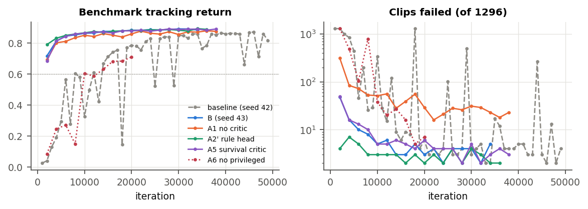
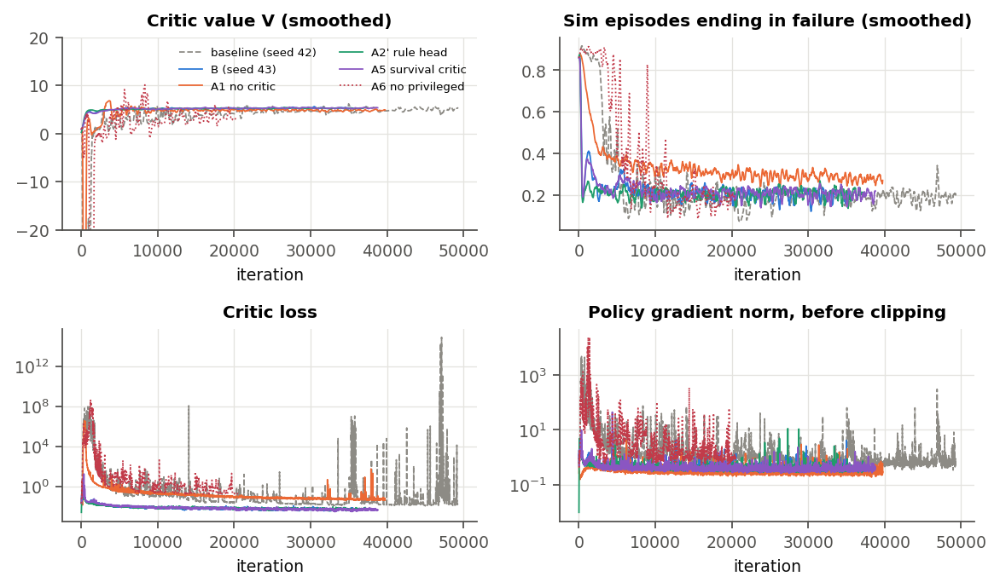

# M4 stability study: catalog and results (started 2026-10-25)

SuperMimic oscillates on `dev`, locally (bf16, replay 500) and on the cluster with the paper's settings
(TF32, replay 1000): see `online_loop.md` and `cluster_runs.md`. This study looks for the cause, one
change at a time. `full` (M5) waits until training is stable (user, 2026-10-25).

## What we know before running anything

**Two mechanisms**, separated by `scripts/supermimic/reward_extremes.py` on the runs' checkpoints. The
script fills a replay with the checkpoint's own policy, then imagines 81,920 rollouts.

1. **The main collapses: the critic goes wrong on live states.**
   - Before a collapse the critic's error on imagined steps is small. At the collapse checkpoint it is
     40–150× larger, on steps before any predicted fall:

     | checkpoints | critic MSE before the fall |
     |---|---|
     | 17,000 → 18,000 (cluster) | 0.036 → 5.1 |
     | 28,000 → 29,000 | 0.020 → 0.84 |
     | 43,000 → 44,000 | 0.018 → 2.8 |

   - Steps after the predicted fall carry only 2–20% of the error.
   - In the training logs the critic's value rises before about half of the failure spikes (M4,
     `cluster_report.pdf`).
   - So the critic overestimates states where the robot is still up, and the policy follows it. Why
     is still open.
2. **The late burst: post-fall extrapolation.**
   - At 47,000 (cluster), 40 of 81,920 rollouts have steps with reward below −1, down to −1.08 million.
   - Every such step comes after both the learned head and the env's rule put the failure probability
     at 1 (survival weight ĉ ≈ 0).
   - The joint-limit penalty dominates (140 of 146 steps). The world model's predicted joints run away
     once it is outside its data, and the penalty is linear in the distance past the limit. Actions stay
     normal-sized.
   - The policy's objective weights those steps by ĉ ≈ 0, but the critic's Eq. 3 fits every step
     unweighted. Post-fall steps are 0.6% of the critic's samples and carry essentially all of its
     squared error (MSE 10⁵ vs 2.1 before the fall).

**The critic doesn't compute penalties.** Rewards come from the analytic reward head on the world
model's predicted state and the action (D5). The critic fits λ-returns of those rewards.

## Run protocol (user, 2026-10-25)

- **Five runs, in parallel on Leonardo, 12 h each.** One A100 per run, the paper's settings (TF32,
  replay 1000), compiled code (D37), all from one commit.
- **One change per run** against the cluster baseline `dev-paper` (seed 42, `cluster_runs.md`). Every
  ablation uses seed 42. B repeats the baseline with seed 43, so smaller differences are not read as
  effects.
- **Benchmark** (`eval.py`, every `dev` clip once from its first frame) of every checkpoint, every 1000
  iterations, on the local GPU after the runs.
- **New logs in every run** (`policy/*`):
  - `reward_min`, `action_rate_min`, `joint_limit_min`, `action_max`: extremes of the imagined
    reward's terms;
  - `extreme_share`: rollouts with a step below −1;
  - `extreme_survival`: the survival weight at those steps.
- **Measured per run, at equal iterations and hours:**
  - benchmark: best and last checkpoint; checkpoints in a collapse (tracking return below 0.6) after
    the run first reaches 0.742; checkpoints with more than 50 failures;
  - training: failure-spike onsets per 10,000 iterations after 5000 (share of episodes ending in a
    failure above 0.5, 300 iterations apart); critic-loss bursts above 10³; extreme-reward iterations.
- **A change "fixes" stability** if, over the same iterations as the baseline:
  - no checkpoint collapses after take-off;
  - spike onsets drop to at most a third of the baseline's;
  - the best tracking return stays within 0.03 of the baseline's.
- **Switches are temporary.** Code switches default to the paper's behavior and are removed once the
  study ends, except the change we adopt.

## The runs

Submitted 2026-10-25 from commit `5eb28ab`. Run folders are `lazyhpc/runs/20261025-153632_<job>_5eb28ab`;
logs are `logs/rsl_rl/supermimic_stability/<time>_<run name>`. Compiled speed on the A100 (smoke test):
1.12 s per iteration (policy 0.77, world model 0.19, collect 0.17; 19.6 GB), against 1.78 s uncompiled,
so about 38,000 iterations in 12 h after a one-time compile of about 12 min.

| id | job | run name |
|---|---|---|
| B | SMB 62261527 | `B-seed43` |
| A1 | SMA1 62261535 | `A1-nocritic` |
| A2′ | SMA2r 62261536 | `A2r-rulehead` |
| A5 | SMA5 62261537 | `A5-survival` |
| A6 | SMA6 62261538 | `A6-noprivileged` |

| id | change | flag | what it tests |
|---|---|---|---|
| B | none, seed 43 | `--agent.seed 43` | run-to-run noise; the compiled code end to end |
| A1 | no critic, H = 32 | `--agent.algorithm.policy.use-critic False` | do the main collapses need the critic? Also the open M4 critic ablation (paper Fig. 4b, the H = 32 cell) |
| A2′ | failure head on the rule's own features: a 64×2 MLP on the root-height and gravity-z errors against the reference, as SuperMimic-Reproduced | `--agent.algorithm.world-model.termination-inputs rule --agent.algorithm.world-model.termination-hidden 64,64` | does the policy exploit our 256×2 head on the full state (D31)? Still a learned head, as in the paper |
| A5 | critic loss weighted by the survival ĉ_t before each step | `--agent.algorithm.critic.survival-weighted True` | the late burst (post-fall states poison the critic), and whether post-fall states also feed the main collapses (2–20% of the critic's error there). Deviation from Eq. 3 |
| A6 | critic without the privileged inputs (root-pose error, time left), zeroed | `--agent.algorithm.critic.privileged-inputs False` | do our critic inputs (D7, D22), absent from the paper, let it extrapolate badly on live states? |

**Not run now, in order of how much they might tell:**
- Uniform start sampling: the critic's value jumps within about 30 iterations, faster than the sampler
  turns the replay over (about 400 iterations).
- Policy learning rate ¼; −J/H: generic, and they say little about the cause.
- The clean previous action in obs (D9): lower prior, and a medium code change.
- Freezing the critic's input normalizer (D34): it is a cumulative mean, nearly fixed after the first
  hour.
- The G1 control (D18): only once the options above are exhausted.

## At 6 h (2026-10-25, training signals only)

All runs compared at iteration 17,670, against the old cluster baseline at the same iteration:

| run | failure spikes after 5k | critic value | gradient >10 | extreme-reward iterations |
|---|---|---|---|---|
| old baseline, seed 42 | 15 | −1.2 to 14 | 53 | not logged |
| B (seed 43) | 0 | 4.9–5.6 | 0 | 4 |
| A1 (no critic) | 0 | 3.4–6.3 | 0 | 39 |
| A2′ (rule-feature head) | 0 | 4.8–5.5 | 0 | 6 |
| A5 (survival-weighted critic) | 0 | 4.8–5.6 | 0 | 0 |
| A6 (no privileged inputs) | 8 | −2.7 to 21.3 | 95 | 542 |

- **The early critic blow-up separates the runs.** The old baseline, A6 and A1 had one in their
  first 3,000 iterations: critic value down to −175…−396, loss 10⁶–10⁸. Those runs took off about
  3,000 iterations late, and the baseline and A6 spiked afterwards. B, A2′ and A5 had none and took
  off by about iteration 300.
- **Likely cause:** early on, the 256×256 learned head misses falls, so post-fall penalties enter the
  objective and the critic unweighted. A2′ and A5 prevent this by design; B avoided it by chance.
- **The code is not the cause.** One update computed with the old and the new code on identical
  inputs agrees to 10⁻⁶ in FP32. In TF32, rounding through the 32-step backward pass alone moves the
  gradient by 3–12%.
- **The sampler concentrates.** Once a policy is good, about half the starts go to about 1% of the
  bins. One clip (`jog_butt_kick_R_loop_002`) gets 17–42%. This is not a collapse trigger.
- **Two clips are infeasible** (D40), and were removed from the dataset.
- **Decisions (user):** A6 stopped at 6 h 17 min. A2′ + A5 made the default (D39), pending the
  benchmark of these runs.

## Results (2026-10-26; full write-up: [stability_report.pdf](stability_report.pdf))

The benchmark uses the 1,296-clip `dev` (`libraries_archive/dev_1296`), every clip once from its first
frame. Checkpoints are every 2000 iterations; the odd thousands are still being added. All runs are cut
at iteration 35,520 (A6: 20,530). Figures and tables come from `make_stability_figures.py`.

| run | early min V | take-off (≥ 0.742) | best (fails / return) | last | collapses after take-off | spikes / 10k | critic-loss bursts |
|---|---|---|---|---|---|---|---|
| old baseline, seed 42 | −277 | 17,000 | 2 / 0.861 | 17 / 0.767 | 3 of 19 | 7.2 | 15 |
| B, seed 43 | 0.3 | 4,000 | 4 / 0.892 | 5 / 0.885 | 0 of 16 | 0 | 0 |
| A1, no critic | −175 | 4,000 | 16 / 0.878 | 23 / 0.871 | 0 of 16 | 0 | 0 |
| A2′, rule-feature head | −0.4 | 2,000 | 2 / 0.894 | 2 / 0.894 | 0 of 17 | 0 | 0 |
| A5, survival-weighted critic | 0.3 | 4,000 | 2 / 0.892 | 3 / 0.891 | 0 of 16 | 0 | 0 |
| A6, no privileged inputs (stopped at 6 h) | −396 | not reached | 7 / 0.711 | 7 / 0.711 | – | 5.8 | 1 |

## Conclusions

- **The oscillation came from an early critic blow-up, and A2′ and A5 each prevent it by design.**
  - Runs whose policy uses a critic that blew up in the first 2000 iterations (baseline, A6) kept
    spiking afterwards.
  - No run that avoided the blow-up ever spiked.
  - B avoided it by chance (seed). A1 blew up its critic, but its policy does not use it.
- **Without the blow-up, training is stable and better.** B, A2′ and A5 rise steadily to 0.885–0.894
  with 2–5 failures. That beats the old baseline's best over its whole 24 h run (0.872), and they get
  there in about 20,000 iterations.
- **A2′ is fastest early:** 4 failures at iteration 2000, against 48–49 for B and A5.
- **The critic helps tracking:** A1 is stable but fails 16–23 clips, against 2–5.
- **Removing the privileged critic inputs does not help:** A6 behaved like the baseline, which has the
  same seed. D7 and D22 stay.
- **Adopted (D39):** A2′ and A5 together. They are now in the 24 h `full` and `dev` runs (`../m5/runs.md`).
- **Caveats:**
  - One run per configuration.
  - Two of the baseline's collapses showed only at odd checkpoints, so "no collapse" is final once the
    odd thousands are benchmarked. The training signals already cover every iteration.

