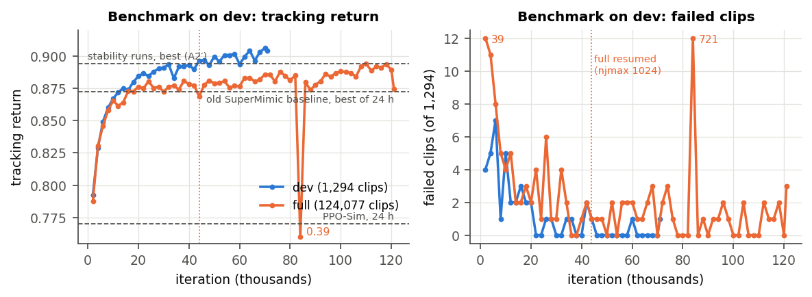
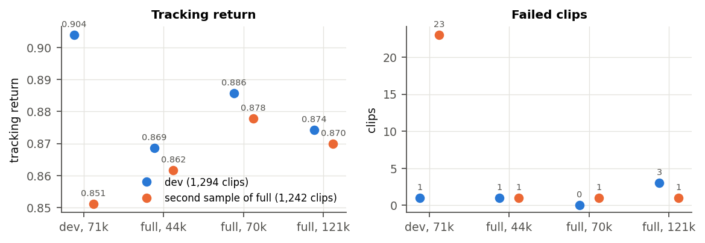
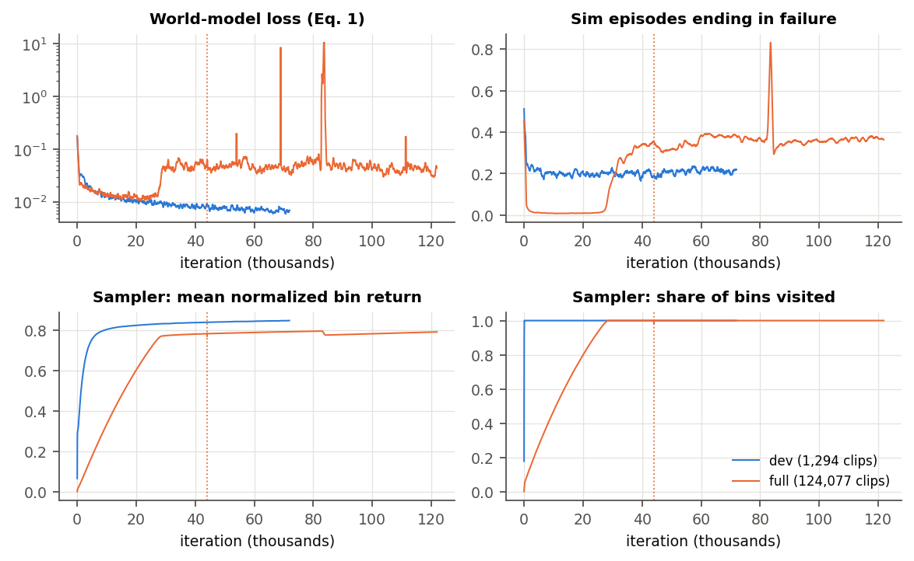

# M5: the 24 h `full` and `dev` runs (final, 2026-10-27)

**What ran.** 24 h jobs on Leonardo, one A100 each, with the same config:
- the paper's settings (TF32, replay 1000);
- the stability fixes as default (D39): a failure head on the rule's two errors and a survival-weighted
  critic loss;
- compiled imagination (D37);
- the reviewed dataset (D40).

| run | job | data | ran | result |
|---|---|---|---|---|
| `dev-24h` | 62300428 (SMdev), `e6f3893` | `dev`: 1,294 clips, 2.55 h | 2026-10-26 01:54 → 10-27 01:58 | finished: 71,910 iterations |
| `full-24h` | 62300423 (SMfull), `e6f3893` | `full`: 124,077 clips, 250.9 h | 2026-10-26 01:54 → 19:18 | went NaN at ~44,620; cancelled (D44) |
| `full-24h`, resumed | 62362613 (SMfull2), `bc44e76` (`njmax` 1024, D44) | `full` | 2026-10-26 19:29 → 10-27 19:33 | finished: 121,870 iterations (from `model_44000`) |

- `full` trained about 40 h in all: 15.9 h up to 44,000 in its first job, then 24 h resumed, 1.11 s per
  iteration. The resumed job had no constraint-buffer overflow and no NaN.
- Run folders: `lazyhpc/runs/20261026-015332_{SMfull,SMdev}_e6f3893`, `lazyhpc/runs/20261026-192504_SMfull2_bc44e76`.
- Logs: `lazyhpc/logs/rsl_rl/supermimic_d39/<time>_{full,dev}-24h`; local copies of the benchmarked
  checkpoints, TensorBoard and job logs in `logs/rsl_rl/supermimic_d39/`.
- ONNX policies (D48): `model_71000.onnx` (`dev`) and `model_121000.onnx` (`full`) next to their checkpoints.
- The dashboards (retarget and MotionBricks) run `dev` 71,000 and `full` 121,000.

**In brief:**
- **Both runs trained without a collapse of their own.** `full`'s only failure was the NaN of its first job
  (a simulator buffer, D44) and one 1,400-iteration dip at 82,700, from which it recovered by itself.
- **On `dev`, `dev` is the best policy:** 0 failed clips, tracking return 0.906 at 70,000. `full` keeps
  improving slowly to 0.894 with 0 failures at 110,000.
- **On motions `dev` never saw, `full` is the better policy:** on a second 2.5 h sample of `full`, `dev`'s
  final policy fails 23 of 1,242 clips (0.851); every `full` checkpoint fails 1 (0.862–0.878).
- **The last checkpoint is not the best:** `full` 121,000 scores 0.874 with 3 failures on `dev`, against
  0.889 with 0 at 120,000. The learning rate is still at 54% of its start when the job ends.
- **The 82,700 dip followed the sampler's concentration on physically impossible references** in the 7-DoF
  data. Those clips are now dropped by a QA rule, and the 7-DoF data is being re-retargeted (D47).

## Benchmark on `dev`

Every checkpoint at a multiple of 2000 (and `full`'s last), on the reviewed 1,294-clip `dev`, every clip once
from its first frame (paper F.1). `full` is one curve: its first job up to 44,000, then the resumed job.
Results: `logs/supermimic_eval/m5_{dev,full}-24h/`; figures: `make_figures.py`.

| | failed clips | tracking return | body error arms / legs / torso |
|---|---|---|---|
| `dev-24h`, 22,000 (7.4 h) | 0 | 0.887 | 5.9 / 4.0 / 1.7 cm |
| `dev-24h`, **70,000** (23.6 h, best) | **0** | **0.906** | **5.4 / 3.6 / 1.4 cm** |
| `dev-24h`, 71,000 (last) | 1 | 0.904 | 5.6 / 3.6 / 1.4 cm |
| `full-24h`, 44,000 (resumed from here) | 1 | 0.869 | 6.1 / 4.2 / 1.6 cm |
| `full-24h`, 84,000 (inside the dip) | 721 | 0.389 | 23.7 / 11.5 / 5.1 cm |
| `full-24h`, **110,000** (best) | **0** | **0.894** | **5.5 / 3.8 / 1.3 cm** |
| `full-24h`, 120,000 | 0 | 0.889 | 5.5 / 4.2 / 1.4 cm |
| `full-24h`, 121,000 (last) | 3 | 0.874 | 5.6 / 3.5 / 1.4 cm |
| PPO-Sim, 24 h (cluster, M4) | 15 | 0.770 | 10.7 arms |
| old SuperMimic baseline, best of 24 h (M4) | 2 | 0.872 | 6.2 arms |
| stability runs, best (A2′, 34,000, M4) | 2 | 0.894 | |

The M4 rows were benchmarked on the 1,296-clip `dev`, which also holds the two clips removed in D40; every
policy failed those, so their failure counts are about 2 higher than they would be here.

- **`dev` kept improving for its whole 24 h:** no failed clip from 46,000 on (one checkpoint with 1), 0.887 at
  22,000 to 0.906 at 70,000.
- **`full` on `dev` improves slowly after the resume:** 0.877 at 46,000, 0.885–0.888 at 70,000–82,000,
  0.887–0.894 from 98,000 on, with 0–3 failures. It stays below `dev` on `dev`'s own clips: `dev` sees each
  of them about 100 times as often.
- **The 84,000 checkpoint fell inside the dip** (721 failures); 86,000 is back at 0 failures and 0.880.

## Motions `dev` never saw: a second sample of `full`

`dev_seed1`: the `dev` recipe (2.5 h stratified by category, `bones_to_library --subset dev --seed 1`), a
second draw from `full`: 1,242 clips, 14 of them also in `dev`. All of them are in `full`'s training data.
Results: `logs/supermimic_eval/m5_seed1/`.

| policy | on `dev` (1,294 clips) | on the second sample (1,242 clips) | body error on the sample, arms / legs / torso |
|---|---|---|---|
| `dev`, 71,000 | 1 failed, 0.904 | 23 failed, 0.851 | 6.8 / 4.3 / 1.7 cm |
| `full`, 44,000 | 1 failed, 0.869 | 1 failed, 0.862 | 6.3 / 4.3 / 1.6 cm |
| `full`, 70,000 | 0 failed, 0.886 | 1 failed, 0.878 | 5.7 / 3.9 / 1.4 cm |
| `full`, 121,000 | 3 failed, 0.874 | 1 failed, 0.870 | 5.7 / 3.5 / 1.4 cm |

- **`dev` does not transfer to new motions:** 23 failures (1.9%) and 0.851 on motions it never trained on.
- **`full` scores the same on both samples** (within 0.01): it has trained on all of them. Its failures stay
  at 1, at every checkpoint.
- So the 250.9 h of `full` buy coverage, not a better score on a small set: one `full` policy handles the
  whole library about as well as `dev` handles its own 2.5 h.

## Training signals (TensorBoard)

- **`full`'s sampler visited every one of its 964,607 bins by about 29,000** iterations. From then on, half
  of its starts go to the hardest 1% of bins (by design: 40% softmax(−25G) plus 10% past weight). So its
  training failure rose from 1% to 34–39%, and its world-model loss from 0.013 to about 0.045. Neither is a
  regression: the mean normalized return over all bins kept rising, 0.766 at 28,000, 0.783 at 44,000,
  0.796 at 82,000 and 0.791 at the end (after the dip).
- **`dev`:** training failure flat at 21–22% (its sampler always has the hardest clips at hand), world-model
  loss 0.010 → 0.007, mean bin return 0.80 → 0.85.
- **Stability:** imagined and simulated 32-step returns correlate at ≥ 0.998 over the last 5,000 iterations
  of both runs. `dev`'s critic loss stays below 0.015 after 3,000 iterations. `full` had one critic-loss
  burst (297, at 83,800, in the dip) and world-model loss spikes above 0.15 at 30,500, 41,500, 46,500,
  53,500, 68,500, 81,500–84,000 and 111,000.
- **Memory:** 33.4 GB (`full`), 19.6 GB (`dev`).

## `full` collapsed at 17.5 h; resumed from 44,000 with a larger constraint buffer (D44)

- **What happened:** at iteration ~44,620 (2026-10-26 ~17:55) the world model, critic and actor went NaN
  within 10 iterations: the logged losses disappear, episodes end after 11 steps, 96% of them fail. The
  checkpoints from 45,000 on are NaN (moved to the run's `nan_quarantine/`); 44,000 is clean.
- **Likely cause:** the simulator's constraint buffer. MuJoCo Warp warned "nefc overflow" about 250 times
  per 100 iterations all run long (up to 636 rows requested, 300 allowed); dropped rows give wrong contact
  physics, and one non-finite state in the replay poisons every network. `dev` warned 263 times in total.
- **Actions (user):** the job was cancelled at 17.4 h, `njmax` raised to 1024 (D44), and `full` resumed
  from `model_44000` for 24 h more. The resumed job had no overflow warning and no NaN.

## The dip at 82,700: impossible references in the hard bins

- **What happened:** at 82,700 the world-model loss spiked, then the policy: training failure 79%, critic
  loss 297, imagined-vs-simulated correlation below 0.9. By 84,100 it had recovered by itself; the 84,000
  checkpoint fails 721 clips, 86,000 none.
- **Where the sampler had put its starts** (its state is in every checkpoint): at 80,000–82,000, four clips
  held about 14% of all starts, `kneeling_loop_102/103__A064` and their mirrors (3.3–3.8% each). After the dip
  the hard bins spread out (top clip 0.7% at 84,000), then `crossed_legs_R_001__A428`–`A432` took the top
  places (3–4% each).
- **Those clips are physically impossible in the 7-DoF data** (pal_mjlab's collision model,
  `kangaroo_bones_seed/pipeline/eval_collisions.py`): in `kneeling_loop` A064 the right knee is 17.4–17.7 cm
  in the floor in every frame; in `crossed_legs` the legs pass 9–14 cm through each other and arms and
  grippers go 16–73 cm into the floor. All of them had passed the dataset QA, which checks link origins
  only (paper E: −12 cm once, −8 cm sustained).
- **Mechanism (likely, one occurrence):** a bin that can never be tracked never earns its return, so the
  hard sampler keeps feeding it. The replay fills with failing contact-rich data from a handful of motions,
  the world model's fit degrades there, and the policy follows the wrong model.
- **Consequences (user, 2026-10-27):**
  - the dataset QA now drops clips with any collision shape more than 5 cm below the floor (both sets);
  - the 7-DoF data is re-retargeted with the GMR fixes made for the 5-DoF set (self-collision avoidance,
    the clip's own floor, torso weight, the IK limits, pal_mjlab's grippers and wrist pairing): D47.

## The last checkpoint is not the best

- `full` 121,000 is worse than 120,000 on most clips (per clip, median −0.007; 63% of clips worse) and
  fails 3, where 120,000 fails none. On the second sample, 121,000 (0.870) is below 70,000 (0.878).
  Consecutive checkpoints usually differ by ±0.003–0.005 per clip. `dev`'s last checkpoint (71,000: 1 failure,
  0.904) is also just below its best (70,000: 0, 0.906).
- **The learning rate is still high when the jobs end.** The paper's cosine schedule decays to 3% over
  250,000 iterations (`lr_decay_iterations`); `full` stops at 121,870 with the rate at 54% of its start,
  `dev` at 71,910 with 82%. So consecutive checkpoints still move around, and the last one is a sample of
  that noise.
- **To make the last checkpoint the best** (the user's rule for the dashboards): decay the learning rate over
  the run's own length, or keep an average of the policy weights. Not done yet.

## Caveats

- One seed per run.
- The benchmark runs with `njmax` 1024 (D44); the first `full` job and `dev` trained with 300, so their
  contacts are now simulated more exactly than in training.
- Each checkpoint took 5.2 min on the local GPU, about 4× the M4 benchmarks; the larger constraint buffer
  is the likely cause (not measured).
- The odd thousands of `dev` were benchmarked up to 19,000 only; the figures use the multiples of 2000.

## The CUDA-graph attempt (D41)

The first pair of these jobs (commit `8f68e36`) used CUDA graphs on the compiled step. An isolated
benchmark on the A100 had shown them 2.8× faster on the policy update and equal to eager. In the
training loop they logged no iteration in 2 h: 100% CPU, idle GPU, and the warning "pending, uninvoked
backwards". They were cancelled at 01:51 and resubmitted without CUDA graphs (`e6f3893`, the same
training code as `31295b6`). About 2 h of both jobs were lost. Making CUDA graphs work in the loop is
open (D41).

## Next

- **7-DoF data:** re-retarget running (D47); the new set replaces `dataset/` with the floor QA rule. Then a
  `full` run on it, benchmarked on a sample of the new set.
- **Learning-rate schedule fitted to the run length** (or a weight average), so the last checkpoint is the
  best. Needs the user's go.
- **5-DoF:** `SMfull5dof` (job 62432587) trains on the full 5-DoF library.
- **Options:** an upper-body goal interface trained on a frozen checkpoint (paper Appendix B; not started).
